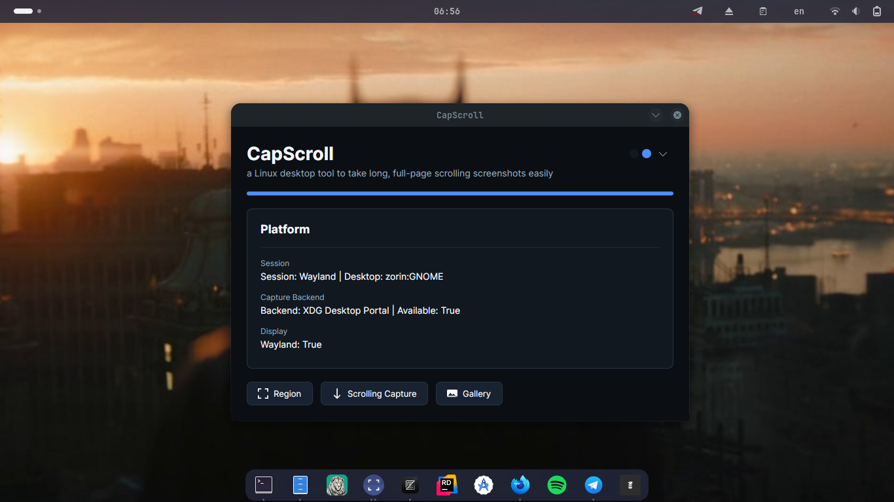
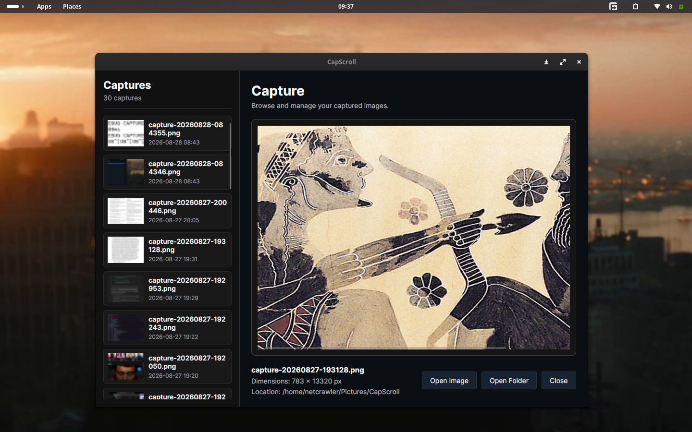
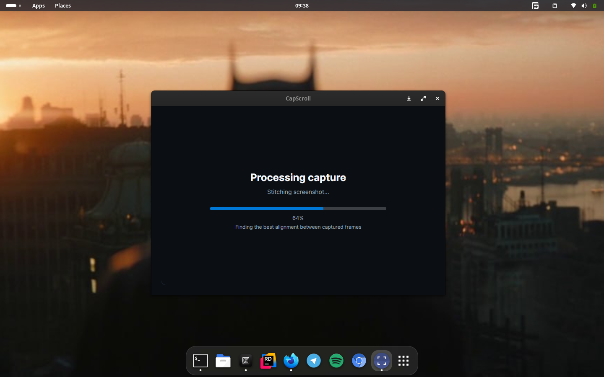

 <div align="center">

<h1>CapScroll</h1>
<p>A Linux scrolling screenshot tool built with .NET and Avalonia UI</p>

<p>
<a href="https://github.com/netcrawlerr/CapScroll/releases"></a>
<a href="https://dotnet.microsoft.com/"></a>
<a href="https://avaloniaui.net/"></a>
<a href="https://www.linux.org/"></a>
<a href="https://www.x.org/"></a>

<a href="LICENSE"></a>
</p>
</div>

CapScroll is a screenshot tool for Linux that makes it easy to capture screen regions and create long screenshots from browsers, terminals, documents, and other scrollable content.

CapScroll supports **X11 and Wayland**, multi-monitor setups, and a wide range of Linux desktop environments.

**Version 1.3.0 introduces a completely refactored Wayland capture pipeline**, replacing desktop-specific screenshot utilities with native C# integration through standard XDG Desktop Portals.

> [!NOTE]
> CapScroll v1.3.0 uses XDG Desktop Portals for Wayland screenshot capture and supported automated input. The required portal services and capabilities depend on your desktop environment.

> [!IMPORTANT]
> **Upgrading from v1.2.1 or earlier?** Previous releases used different screenshot and input mechanisms, including desktop-specific screenshot utilities, `grim`, and `ydotool`. Those legacy dependencies are no longer required by the new portal-based screenshot pipeline in v1.3.0. Automated input may still use `ydotool` as a fallback.


## Overview

CapScroll supports both regular screenshots and scrolling screenshots.

For scrolling captures, CapScroll:

- Spans the virtual desktop across connected monitors.
- Captures the selected region.
- Automatically scrolls the content when the active display backend supports the required input operations.
- Captures subsequent frames.
- Detects when the end of the content is reached.
- Detects overlap between frames.
- Aligns and stitches the frames into a single image.

The goal is to make long screenshots as simple as selecting an area and letting CapScroll handle the rest.

## Demo

> [!NOTE]
> Watch CapScroll in action with a scrolling screenshot demonstration.

[**▶ Watch Demo**](https://drive.google.com/file/d/1aLgQzf764prA_aX1Y7y1hyhJgYGu5rjU/view?usp=sharing)

## Screenshots

<table>
<tr>
<td width="100%">

</td>
</tr>
<tr>
<td width="100%">

</td>
</tr>
<tr>
<td width="100%">

</td>
</tr>
</table>

## Features

- Region capture
- **Multi-monitor support**
- Scrolling screenshot capture
- Automatic scrolling on X11
- Wayland screenshot capture through XDG Desktop Portals
- Automated Wayland scrolling when the required portal input capabilities are available
- `ydotool` fallback for supported input configurations
- Automatic bottom-of-content detection
- Automatic frame alignment and stitching
- Dynamic overlap detection
- Capture cancellation
- Stitching progress reporting
- Capture preview
- Open captured image
- Open capture folder
- PNG output
- `.deb`, `.AppImage`, `.rpm`, and portable `.tar.gz` packaging
- X11 and Wayland support

## Supported Content

CapScroll can be useful for capturing:

- Web pages
- PDF documents
- Terminal output
- Long application views
- Documents
- Chat conversations
- Any other scrollable content

> [!NOTE]
> Results may vary depending on how the target application renders content and handles scrolling.

## Desktop Environment and Display Server

CapScroll is designed for Linux desktop environments using X11 or Wayland. It uses native X11 integration on X11 sessions and XDG Desktop Portals for Wayland screenshot capture.

The portal-based approach is intended to work across desktop environments that provide compatible portal implementations, rather than being limited to a specific distribution or desktop.

| Desktop Environment | X11 | Wayland | Multi-Monitor |
|---|---|---|---|
| GNOME | Supported | Supported | Supported |
| KDE Plasma | Supported | Supported | Supported |
| COSMIC (Pop!\_OS) | — | Supported | Supported |
| XFCE | Supported | Depends on available portal and session capabilities | Supported |

**Wayland compatibility:** Actual screenshot and input capabilities depend on the desktop environment, compositor, installed portal backend, and granted permissions. Other Linux desktop environments may work when they provide the required interfaces.

## Requirements

### General

- Linux
- .NET 10 for running framework-dependent builds or building from source
- An active desktop session and D-Bus session bus

### X11

Native X11 capture and input use the system's X11 libraries:

- `libX11`
- `libXtst`

Prebuilt packages may handle application dependencies according to their packaging configuration. Development headers are needed when building native integrations from source.

### Wayland

Wayland screenshot capture requires:

- `xdg-desktop-portal`
- A compatible desktop-specific portal backend
- An active D-Bus session bus

Common portal backends include:

- `xdg-desktop-portal-gnome`
- `xdg-desktop-portal-kde`
- `xdg-desktop-portal-cosmic`

The relevant services must be available and support the requested screenshot operation.

For automated scrolling, the active portal backend must additionally provide the necessary RemoteDesktop input functionality and permissions. The `ydotool` fallback may be used when applicable.

> [!TIP]
> Install the portal backend appropriate for your desktop environment. You do not need to install every desktop's screenshot utility.

### Dependencies Used by Previous Releases

CapScroll v1.1.0–v1.2.1 used various desktop-specific screenshot utilities and input tools, depending on the environment:

- `gnome-screenshot`
- `spectacle`
- `cosmic-screenshot`
- `grim`
- `ydotool` and `ydotoold`

The old screenshot utilities are no longer required by the v1.3.0 portal-based screenshot pipeline. `ydotool` remains a possible fallback for automated input.

If you are upgrading, you do not need to install these legacy screenshot utilities specifically for CapScroll v1.3.0. You can keep them if other applications use them.

## Currently Tested On

CapScroll has been tested on the following Linux distributions:

- Kali Linux
- Zorin OS
- Ubuntu
- Fedora Workstation 44
- Pop!\_OS (COSMIC)

Testing has covered these desktop environments and display sessions:

- GNOME on X11 and Wayland
- KDE Plasma on X11 and Wayland
- XFCE on X11 and Wayland
- COSMIC on Wayland

**These are tested environments, not an exhaustive list of supported Linux distributions.** CapScroll is intended to work on other Linux distributions and desktop environments when the required display-session, portal, and system-library capabilities are available.

## Installation

Download the latest release from the [GitHub Releases page](https://github.com/netcrawlerr/CapScroll/releases).

### Debian Package

For Debian-based distributions such as Debian, Ubuntu, Linux Mint, and Kali Linux, download the `.deb` package and install it with:

```bash
sudo apt install ./capscroll_<VERSION>_amd64.deb
```

Replace `<VERSION>` with the version in the downloaded filename.

### AppImage

Download the AppImage release, make it executable, and launch it:

```bash
chmod +x CapScroll-*.AppImage
./CapScroll-*.AppImage
```

Portal services and any required system libraries must still be available on the host system.

### RPM Package

For Fedora and other RPM-based distributions, install the downloaded RPM package:

```bash
sudo dnf install ./capscroll-<VERSION>.rpm
```

Adjust the filename to match the release artifact.

## Build From Source

### Prerequisites

- Git
- .NET 10 SDK
- Native development libraries required by your build environment

### Clone the repository

```bash
git clone https://github.com/netcrawlerr/CapScroll.git
cd CapScroll
```

### Build

Run the provided build script:

```bash
chmod +x ./scripts/build.sh
./scripts/build.sh
```

The script automates the project's build and packaging process. Refer to the script for the available options and generated artifact locations.

## How to Use

### Normal Capture

1. Start CapScroll.
2. Select **Capture Region**.
3. Select the area to capture.
4. CapScroll captures the selected region.
5. The image is saved automatically.

### Scrolling Capture — X11

1. Select **Scrolling Capture**.
2. Select the scrollable area.
3. CapScroll captures the initial view.
4. CapScroll automatically scrolls the content.
5. Additional frames are captured.
6. CapScroll detects when the bottom of the content is reached.
7. The frames are aligned and stitched together.
8. The completed long screenshot is displayed.

### Scrolling Capture — Wayland

1. Ensure the appropriate XDG Desktop Portal services are available.
2. Select **Scrolling Capture**.
3. Select the scrollable area.
4. Approve any portal permission prompts if they appear.
5. CapScroll captures the initial view.
6. CapScroll uses the portal-based input path when supported, with a `ydotool` fallback where applicable.
7. If automated input is unavailable, manually scroll the selected content when the workflow permits it.
8. CapScroll captures subsequent frames.
9. CapScroll detects when the content stops changing.
10. The frames are automatically aligned and stitched together.

> [!TIP]
> Automated scrolling on Wayland depends on the capabilities and permissions provided by the active portal backend. Manual scrolling may be necessary when automated input is unavailable.

## Stop Scrolling Capture

Use the application's cancellation control. Where supported, you can also press:

```text
Ctrl + Shift + Esc
```

Moving the mouse pointer outside the selected capture area can stop scrolling capture in workflows that use pointer position as part of the capture process.

> [!NOTE]
> Available cancellation behavior depends on the active capture workflow.

## Output

Captured images are saved as PNG files.

By default, captures are stored in:

```text
~/Pictures/CapScroll/
```

Example filename:

```text
capture-YYYYMMDD-HHmmss.png
```

## Current Limitations

- CapScroll currently targets Linux; Windows and macOS are not supported.
- Wayland functionality depends on the active portal backend and compositor capabilities.
- Dynamic content may produce imperfect stitching.

## License

CapScroll is licensed under the [MIT License](LICENSE).
